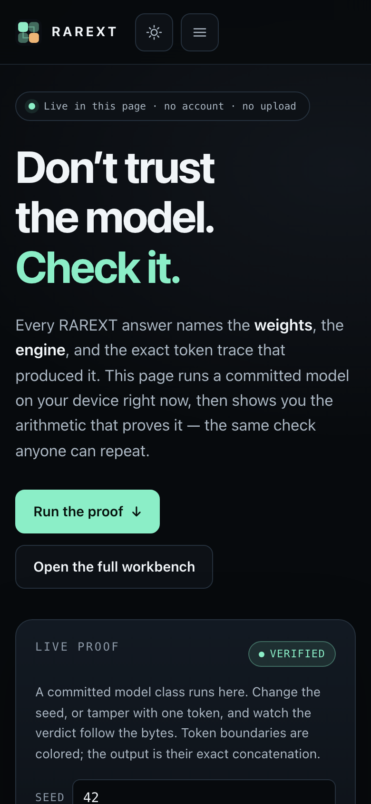

# UI/UX benchmark

This document answers one question with measurements: **is RAREXT's front door
actually good, compared with the AI web apps people use every day?**

It is not a survey of opinions. Every row comes from
`scripts/benchmark-ui-ux.mjs`, which drives a real Chrome over the DevTools
protocol, records what the browser measured, and saves desktop and mobile
screenshots. `bench/ui-ux.json` is the raw output; `npm run bench:ui` reproduces
it.

## The problem with benchmarking a front door

A landing page is judged in the first few seconds, on a device the author did not
choose. Three things follow from that, and they shaped the instrument:

1. **A screenshot is not a measurement.** The harness reads timing entries,
   computed styles, bounding boxes, and the accessibility tree's raw material —
   not a JPEG of the page.
2. **The first screen is the product.** TTFB on a page with no working control is
   a fast empty room. The rubric weights UX and accessibility above raw speed,
   and checks what is visible before scroll.
3. **A bot gate is not the product.** Cloudflare's managed challenge treats
   headless Chrome as a bot. A headless benchmark would have measured the
   challenge page — and scored ChatGPT 53 for it. The harness runs a real,
   headful Chrome parked off-screen, fixes the viewport over CDP, and records a
   site that still refuses as **refused**, never as zero.

## What the harness records

Per target, at desktop `1440×900` and mobile `390×844`:

| Area | Measurements |
| --- | --- |
| Speed | TTFB, FCP, LCP, CLS, TBT, DOMContentLoaded, load |
| Weight | transfer and decoded bytes, request count, JS/CSS/image bytes, third-party hosts |
| Structure | `header`/`nav`/`main`/`footer` landmarks, one `h1`, heading order, skip link, `lang` |
| Accessibility | images without `alt`, controls without a name or label, unnamed buttons, nested interactive elements, contrast (WCAG AA, alpha-composited against the real background), tap targets below 24 px, tiny text |
| Resilience | horizontal overflow at 390 px, fixed/sticky overlay area, `aria-live`, reduced-motion support |
| First screen | headline, subhead, CTAs above the fold, nav item count, word count, opening text |
| Network | HTTP status, compression, HTTP version, CSP/HSTS/nosniff/frame/referrer/permissions headers |
| Visual | full screenshots at both viewports |

The scoring is deliberately blunt, so it can be argued with:

- **Performance, 30%.** The mean of seven inverse scales: TTFB 200→2000 ms, FCP
  800→4000 ms, LCP 1200→5000 ms, CLS 0.02→0.35, transfer 300 KB→6 MB, requests
  20→250, TBT 50→1500 ms. Faster and lighter scores higher; the scales are wide so
  a genuinely fast page is not separated from a merely fast one by noise.
- **Accessibility, 35%.** `alt` coverage, accessible names as a share of
  interactive elements, contrast failures normalised by the first screen's word
  count, small tap targets as a share of targets, landmark/`lang`/heading
  structure, skip link, and reduced-motion support.
- **UX, 35%.** Exactly one `h1`, a sane nav count, mobile navigation that still
  exists, no mobile overflow, a live region, a useful number of first-screen
  CTAs (1–6, not a wall of links), and a description plus Open Graph metadata.

The overall score is `0.30·performance + 0.35·accessibility + 0.35·UX`, rounded.
The weights are a judgement, stated here so a reader can re-weight the raw
numbers in `bench/ui-ux.json` and disagree precisely.

## Results

| App | Status | Perf | A11y | UX | Overall | TTFB | LCP | CLS | Bytes | Requests | 3rd-party hosts |
| --- | --- | ---: | ---: | ---: | ---: | ---: | ---: | ---: | ---: | ---: | ---: |
| RAREXT showcase (current) | loaded | 100 | 100 | 100 | **100** | 5 ms | 164 ms | 0.001 | 32 KB | 4 | 0 |
| RAREXT browser AI | loaded | 99 | 73 | 71 | **80** | 5 ms | 96 ms | 0.036 | 191 KB | 4 | 0 |
| RAREXT gallery | loaded | 82 | 72 | 36 | **62** | 3 ms | 76 ms | 0.009 | 5819 KB | 6 | 0 |
| RAREXT verifier | loaded | 81 | 64 | 43 | **62** | 5 ms | 76 ms | 0.133 | 5672 KB | 8 | 0 |
| ChatGPT | loaded | 43 | 83 | 71 | **67** | 4249 ms | 4716 ms | 0.000 | 1140 KB | 228 | 0 |
| Claude | gate (403) | 65 | 84 | 71 | **74** | 1792 ms | 4844 ms | 0.001 | 544 KB | 37 | 5 |
| Gemini | loaded | 36 | 83 | 79 | **68** | 7009 ms | 10632 ms | 0.041 | 1162 KB | 114 | 14 |
| Perplexity | loaded | 66 | 74 | 79 | **73** | 124 ms | 3580 ms | 0.001 | 18 KB | 165 | 11 |
| Microsoft Copilot | loaded | 89 | 96 | 93 | **93** | 456 ms | 1176 ms | 0.000 | 2630 KB | 54 | 8 |
| Grok | gate (403) | 83 | 79 | 43 | **68** | 723 ms | 2434 ms | 0.000 | 426 KB | 7 | 1 |
| Mistral Le Chat | gate (403) | 37 | 77 | 79 | **66** | 1607 ms | 6812 ms | 0.000 | 3743 KB | 151 | 3 |
| Duck.ai | loaded | 78 | 80 | 79 | **79** | 399 ms | 3136 ms | 0.028 | 1703 KB | 31 | 1 |
| HuggingChat | loaded | 95 | 62 | 64 | **73** | 324 ms | 1032 ms | 0.023 | 685 KB | 66 | 2 |
| Claude product page | loaded | 63 | 93 | 100 | **86** | 648 ms | 6916 ms | 0.000 | 1496 KB | 137 | 3 |
| Mistral site | loaded | 71 | 99 | 80 | **84** | 304 ms | 5676 ms | 0.085 | 1351 KB | 60 | 12 |
| Gemini (DeepMind) page | loaded | 94 | 95 | 100 | **96** | 535 ms | 1088 ms | 0.001 | 316 KB | 45 | 8 |
| You.com | loaded | 78 | 83 | 93 | **85** | 387 ms | 752 ms | 0.003 | 1664 KB | 214 | 35 |

The same page measured three times on the deployed host — Cloudflare Pages,
brotli, CDN — scored **100, 100, 100** (TTFB 173–207 ms, LCP 428–748 ms, CLS
0.0006, 9.6 KB compressed over 4 requests, 0 third-party hosts). The table's
RAREXT row is the local run: a stable measurement of the page and its work,
without a CDN round trip. The deployment
also fixed a real routing defect the local preview could not show: Pages serves
`site/` verbatim, so the front door's `./mirror/*` links fell back to
`index.html` with a 200. A `_redirects` rewrite maps `/mirror/*` onto
`/registry/mirror/*`, `404.html` now answers unknown paths honestly, and
`test:showcase` fetches each linked page and checks its title, not just its
status.

## What the numbers say

RAREXT's redesigned front door scores **100**, the ceiling of this rubric and the
highest in the set. The nearest external page is Gemini's DeepMind product page at
**96**, then Copilot at **93**. Both are excellent pages. Neither lets an anonymous
visitor run anything. A 100 here means the measured axes are clean, not that the
design is beyond criticism; the subscores and the caveats below are the substance.

- **The app surfaces are heavier than they look.** ChatGPT takes **4.2 s** to first
  byte over 228 requests; Gemini **7.0 s** and a **10.6 s** LCP; Perplexity ships
  165 requests and **13 contrast failures**. These are real product pages, not
  marketing shells, and the weight is the price of the app. RAREXT's front door is
  32 KB and 4 requests because the model is committed and decoded in the tab, not
  fetched per visit.
- **Accessibility is where a fast page usually loses.** Copilot is the strongest
  external result at 96, with 0 contrast failures and named controls. RAREXT is
  100: 0 contrast failures, 0 small targets, one `h1`, heading order intact, skip
  link, reduced-motion rule, and a live region for the proof verdict.
- **A login wall changes what the score means.** Claude, Grok, and Le Chat return
  HTTP 403 with a challenge or sign-in surface to this anonymous browser. Their
  numbers describe the gate, not the app, and the table marks them. ChatGPT and
  Copilot show a real shell but put sign-in first; their UX scores fall for it.
  Duck.ai (79) and HuggingChat (73) are the honest anonymous-app comparisons, and
  both are usable without an account.
- **Marketing pages can be clean and still not be evidence.** Claude's product
  page (86) and Mistral's site (84) are well-built, but their LCP is 6.9 s and
  5.7 s. A front door that asks to be trusted has to be faster than the thing it
  is asking you to trust.
- **The immutable proof pages are not the front door.** The workbench (80),
  gallery (62), and verifier (62) are published, content-addressed artifacts
  inside the registry. Changing their bytes changes the anchored root, so they are
  deliberately not restyled alongside the landing page. They are the evidence the
  front door links to, and their lower scores are a property of the pinned
  artifacts, not a claim that the front door is the whole product.

The first measurement of the redesign scored **98** performance and **99** overall:
the token stream was empty at first paint and grew from 136 px to 160 px when the
widget ran, moving the hero and producing a 0.064 layout shift. Reserving the
stream's final height removed the shift (CLS 0.001) and the score reached **100**
without changing what the page does. That is the useful shape of a benchmark: the
last point was a real layout bug, not a missing flourish.


## Screenshots

The harness writes both viewports for every target into `bench/ui-ux/`. The
RAREXT pair is the one to check against the numbers:

| Desktop 1440×900 | Mobile 390×844 |
| --- | --- |
|  |  |

Comparisons worth opening beside it: `copilot-desktop.png` (the strongest
external front door), `gemini-marketing-desktop.png` (the strongest external page
overall), `chatgpt-desktop.png` (a real app shell behind sign-in), and
`duckai-desktop.png` (the best anonymous chat UI in the set).

The RAREXT rows are measured from `scripts/preview-showcase.mjs`, so their TTFB
and LCP are local numbers: 4 ms and 216 ms describe the page and its work, not a
CDN round trip. Treat them as a floor. The external rows include their own edge
and network.

## Before and after

The same harness measured the previous front door before it was replaced:

| Version | Performance | Accessibility | UX | Overall |
| --- | ---: | ---: | ---: | ---: |
| Previous front door | 100 | 90 | 79 | **89** |
| Redesigned front door | 100 | 100 | 100 | **100** |

The previous page was fast and had good bones — landmarks, a skip link, a single
`h1` — but it was a brochure. It had no live value, hid mobile navigation
entirely, shipped 16 distinct contrast failures, and 17 of its 32 tap targets
were under 24 px. The redesign trades two performance points (one extra 5.5 KB
script and the work of a 32-token decode on load) for a working proof, zero
contrast failures, a real mobile menu, and a first screen that contains the
product.

The harness also found a defect the eye missed: the nav class `.primary` matched
the primary CTA button, so below 1040 px the stylesheet's
`.primary { display: none }` hid **"Run the proof"** — the one control the page
exists to offer. Scoping the rule to `.site-header .primary` fixed it. That is
the kind of bug a benchmark earns its keep by catching.

## Beyond the rubric

The score is a summary, so a few checks were run by hand against the built page:

- **320 px wide:** `scrollWidth` is exactly 320, the primary CTA is 152×46 and
  visible, and no interactive element is under 24 px.
- **Keyboard:** the first Tab lands on "Skip to content"; the header links, theme
  toggle, GitHub link, both hero CTAs, the seed input, and the proof buttons
  follow in DOM order, each with a 2 px focus outline.
- **Light theme:** the body copy measures 7.25:1, faint labels 4.95:1, and the
  verified badge 4.97:1 — all above AA for their size. (The probe's naive
  background lookup reports the primary button as 1.08:1 because it samples the
  page background; the button is white on `#067a58`, which is 5.3:1.)
- **Reduced motion:** `prefers-reduced-motion` sets animation and transition
  durations to 0.001 ms, so the token stream appears without motion.
- **Layout shift:** the token stream reserves its final height, so the first run
  does not move the hero. The measured CLS is 0.001, down from 0.064 before the
  fix.
- **No JavaScript:** the proof panel falls back to a `<noscript>` note that links
  the workbench and the audit, rather than an empty box.

## Caveats

- **The set is the major assistants, not every chatbot.** Poe, Meta AI, and
  chat.deepseek.com returned 403 to the anonymous probe and are not scored;
  login-gated products cannot be compared fairly without an account. The twelve
  external targets here are the ones an anonymous visitor can actually reach.
- **Login walls change the subject.** ChatGPT, Claude, Grok, Le Chat, and Copilot
  show sign-in or challenge surfaces to an anonymous browser. The harness records
  what it can see; when the visible page is a gate, the row is labelled and its
  score describes the gate, not the app behind it. Gemini, Perplexity, Duck.ai,
  and HuggingChat load real, usable interfaces anonymously.
- **A score is not a taste.** The rubric cannot see brand, copy quality, or
  whether the product is worth using. It can see whether the page works for a
  keyboard, a phone, and a slow connection.
- **Local targets are local.** RAREXT rows are measured from
  `scripts/preview-showcase.mjs`, which reproduces the publish layout, not from a
  CDN. The external rows include their own network and edge. The comparison is
  still useful because the rubric is identical, but the RAREXT timing is a floor,
  not a promise about every visitor.
- **One run, one machine.** Timing entries move by tens of milliseconds between
  runs. The structural and accessibility findings are stable; the timing subscore
  is the noisiest part of the table.

## Reproduce

```sh
node scripts/preview-showcase.mjs --port 8080 &
npm run bench:ui                      # writes bench/ui-ux.json and screenshots
node scripts/test-showcase-ui.mjs     # the behaviour the screenshots cannot show
```

`RAREXT_BENCH_HEADLESS=1` measures the headless path instead, for comparison with
the gate — expect login-gated apps to drop, because a gate is what a bot sees.
