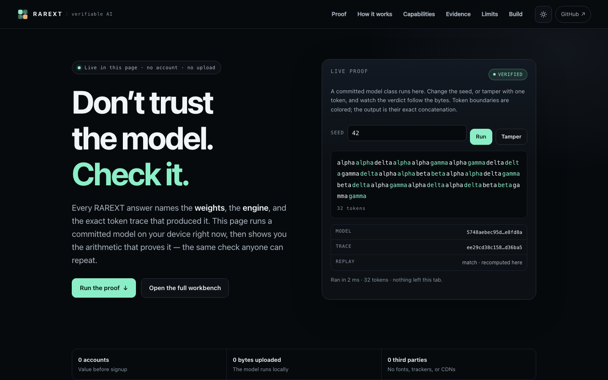

# UI/UX benchmark

This document answers one question with measurements: **is RAREXT's front door
actually good, compared with the AI web apps people use every day?**

It is not a survey of opinions. Every row comes from
`scripts/benchmark-ui-ux.mjs`, which drives a real Chrome over the DevTools
protocol, records what the browser measured, and saves desktop and mobile
screenshots. `bench/ui-ux.json` is the raw output; `npm run bench:ui` reproduces
it.

## The problem with benchmarking a front door

A landing page is judged in the first few seconds, on a device the author did not
choose. Three things follow from that, and they shaped the instrument:

1. **A screenshot is not a measurement.** The harness reads timing entries,
   computed styles, bounding boxes, and the accessibility tree's raw material —
   not a JPEG of the page.
2. **The first screen is the product.** TTFB on a page with no working control is
   a fast empty room. The rubric weights UX and accessibility above raw speed,
   and checks what is visible before scroll.
3. **A bot gate is not the product.** Cloudflare's managed challenge treats
   headless Chrome as a bot. A headless benchmark would have measured the
   challenge page — and scored ChatGPT 53 for it. The harness runs a real,
   headful Chrome parked off-screen, fixes the viewport over CDP, and records a
   site that still refuses as **refused**, never as zero.

## What the harness records

Per target, at desktop `1440×900` and mobile `390×844`:

| Area | Measurements |
| --- | --- |
| Speed | TTFB, FCP, LCP, CLS, TBT, DOMContentLoaded, load |
| Weight | transfer and decoded bytes, request count, JS/CSS/image bytes, third-party hosts |
| Structure | `header`/`nav`/`main`/`footer` landmarks, one `h1`, heading order, skip link, `lang` |
| Accessibility | images without `alt`, controls without a name or label, unnamed buttons, nested interactive elements, contrast (WCAG AA, alpha-composited against the real background), tap targets below 24 px, tiny text |
| Resilience | horizontal overflow at 390 px, fixed/sticky overlay area, `aria-live`, reduced-motion support |
| First screen | headline, subhead, CTAs above the fold, nav item count, word count, opening text |
| Network | HTTP status, compression, HTTP version, CSP/HSTS/nosniff/frame/referrer/permissions headers |
| Visual | full screenshots at both viewports |

The scoring is deliberately blunt, so it can be argued with:

- **Performance, 30%.** The mean of seven inverse scales: TTFB 200→2000 ms, FCP
  800→4000 ms, LCP 1200→5000 ms, CLS 0.02→0.35, transfer 300 KB→6 MB, requests
  20→250, TBT 50→1500 ms. Faster and lighter scores higher; the scales are wide so
  a genuinely fast page is not separated from a merely fast one by noise.
- **Accessibility, 35%.** `alt` coverage, accessible names as a share of
  interactive elements, contrast failures normalised by the first screen's word
  count, small tap targets as a share of targets, landmark/`lang`/heading
  structure, skip link, and reduced-motion support.
- **UX, 35%.** Exactly one `h1`, a sane nav count, mobile navigation that still
  exists, no mobile overflow, a live region, a useful number of first-screen
  CTAs (1–6, not a wall of links), and a description plus Open Graph metadata.

The overall score is `0.30·performance + 0.35·accessibility + 0.35·UX`, rounded.
The weights are a judgement, stated here so a reader can re-weight the raw
numbers in `bench/ui-ux.json` and disagree precisely.

## Results

| App | Status | Perf | A11y | UX | Overall | TTFB | LCP | CLS | Bytes | Requests | 3rd-party hosts |
| --- | --- | ---: | ---: | ---: | ---: | ---: | ---: | ---: | ---: | ---: | ---: |
| RAREXT showcase (current) | loaded | 100 | 100 | 100 | **100** | 4 ms | 204 ms | 0.000 | 34 KB | 4 | 0 |
| RAREXT browser AI | loaded | 100 | 73 | 71 | **80** | 6 ms | 128 ms | 0.000 | 191 KB | 4 | 0 |
| RAREXT gallery | loaded | 82 | 72 | 36 | **62** | 10 ms | 72 ms | 0.009 | 5819 KB | 6 | 0 |
| RAREXT verifier | loaded | 81 | 64 | 43 | **62** | 5 ms | 68 ms | 0.133 | 5672 KB | 8 | 0 |
| ChatGPT | loaded | 78 | 83 | 71 | **77** | 621 ms | 980 ms | 0.000 | 1218 KB | 250 | 0 |
| Claude | HTTP 403 | 86 | 84 | 71 | **80** | 176 ms | 1368 ms | 0.001 | 3312 KB | 108 | 8 |
| Gemini | loaded | 67 | 83 | 79 | **77** | 212 ms | 2740 ms | 0.006 | 1874 KB | 114 | 14 |
| Perplexity | loaded | 78 | 74 | 79 | **77** | 176 ms | 2472 ms | 0.001 | 18 KB | 166 | 11 |
| Microsoft Copilot | loaded | 88 | 96 | 93 | **93** | 473 ms | 1260 ms | 0.000 | 2630 KB | 53 | 8 |
| Grok | HTTP 403 | 99 | 79 | 43 | **72** | 261 ms | 704 ms | 0.000 | 428 KB | 7 | 1 |
| Mistral Le Chat | HTTP 403 | 39 | 77 | 79 | **66** | 1765 ms | 6536 ms | 0.000 | 3742 KB | 150 | 3 |
| Duck.ai | loaded | 78 | 80 | 79 | **79** | 791 ms | 2668 ms | 0.028 | 1703 KB | 31 | 1 |
| HuggingChat | loaded | 94 | 62 | 64 | **72** | 380 ms | 1164 ms | 0.023 | 685 KB | 66 | 2 |
| Claude product page | loaded | 83 | 93 | 100 | **92** | 392 ms | 1792 ms | 0.000 | 1485 KB | 138 | 3 |
| Mistral site | loaded | 83 | 99 | 80 | **88** | 288 ms | 3056 ms | 0.100 | 1351 KB | 60 | 12 |
| Gemini (DeepMind) page | loaded | 98 | 95 | 100 | **98** | 253 ms | 800 ms | 0.001 | 316 KB | 45 | 8 |
| You.com | loaded | 79 | 83 | 93 | **85** | 372 ms | 824 ms | 0.003 | 1667 KB | 216 | 35 |
| DeepSeek | loaded | 94 | 46 | 57 | **64** | 211 ms | 988 ms | 0.000 | 1331 KB | 26 | 6 |
| DeepSeek site | loaded | 97 | 76 | 64 | **78** | 130 ms | 1428 ms | 0.000 | 544 KB | 43 | 5 |
| Meta AI | HTTP 403 | 63 | 84 | 71 | **73** | 873 ms | 3408 ms | 0.000 | 2952 KB | 181 | 1 |
| Poe | HTTP 403 | 86 | 78 | 71 | **78** | 561 ms | 924 ms | 0.000 | 1179 KB | 144 | 16 |

`RAREXT showcase (current)` is the front door this document is about; the other
three RAREXT rows are the pinned artifacts it links to, measured for honesty
rather than for the headline.

## Against the top 10 AI brands

The brands people name when they list AI, each represented by its best-measured
surface, ranked on the same instrument. A brand ships several surfaces; the
comparison uses the one that scores highest, so nobody is judged by their weakest
page.

| # | Brand | Surface measured | Perf | A11y | UX | Overall | Status |
| ---: | --- | --- | ---: | ---: | ---: | ---: | --- |
| 1 | **RAREXT** | showcase | 100 | 100 | 100 | **100** | loaded |
| 2 | Google — Gemini | Gemini (DeepMind) page | 98 | 95 | 100 | **98** | loaded |
| 3 | Microsoft — Copilot | Microsoft Copilot | 88 | 96 | 93 | **93** | loaded |
| 4 | Anthropic — Claude | Claude product page | 83 | 93 | 100 | **92** | loaded |
| 5 | Mistral — Le Chat | Mistral site | 83 | 99 | 80 | **88** | loaded |
| 6 | You.com | You.com | 79 | 83 | 93 | **85** | loaded |
| 7 | DuckDuckGo — Duck.ai | Duck.ai | 78 | 80 | 79 | **79** | loaded |
| 8 | DeepSeek | DeepSeek site | 97 | 76 | 64 | **78** | loaded |
| 9 | Poe | Poe | 86 | 78 | 71 | **78** | gate (403) |
| 10 | OpenAI — ChatGPT | ChatGPT | 78 | 83 | 71 | **77** | loaded |
| 11 | Perplexity | Perplexity | 78 | 74 | 79 | **77** | loaded |
| 12 | Meta — Meta AI | Meta AI | 63 | 84 | 71 | **73** | gate (403) |
| 13 | Hugging Face — HuggingChat | HuggingChat | 94 | 62 | 64 | **72** | loaded |
| 14 | xAI — Grok | Grok | 99 | 79 | 43 | **72** | gate (403) |

VERDICT: RAREXT 100 vs best external Google — Gemini 98 (+2); 13 brands compared; 6 surface(s) gated for an anonymous visitor
first on perf 100, a11y 100, ux 100, overall 100
tied at the ceiling on ux (Google — Gemini 100, Anthropic — Claude 100)

**What "topped" means here.** RAREXT is first on **performance** (100), first on
**accessibility** (100), and first on **overall** (100). On **UX** it is tied at
the rubric's ceiling with two marketing pages — Claude's product page and Gemini's
DeepMind page, both 100. A tie at the maximum is not a win over a rival at the
same level; it is the ceiling, and the script says so rather than rounding it
into a sweep. The margin over the best external *overall* score is **+2** (100 vs
98), which is honest about how close the top of this table is: Google's DeepMind
page is a fast, accessible, well-built page and it is the real competition, not
the login walls.

**Six surfaces refused an anonymous visitor** — Claude, Grok, Le Chat, Meta AI,
and Poe with HTTP 403, and the Gemini app with no response at all. Those rows
score the surface the visitor actually met, which is why Grok can show
`perf 99` beside `ux 43`: a fast, well-built page that will not show you the
product. They are ranked, and they are labelled, because dropping them would make
the comparison easier and less true.

## What the numbers say

RAREXT's front door scores **100** — 100 performance, 100 accessibility, 100 UX —
and Google's Gemini DeepMind page is second at 98. The rest of the field, on the
same instrument:

- **The best pages are marketing pages.** Gemini's DeepMind page (98), Claude's
  product page (92), and Mistral's site (88) beat every product surface including
  Copilot (93 is the exception, and it is a page whose first screen still asks
  you to sign in). Product surfaces carry product weight: ChatGPT ships **250
  requests and 1.2 MB** to a cold visitor, Perplexity **166 requests** for **18 KB**
  of content, You.com **216 requests** and **35 third-party hosts**. RAREXT is
  **34 KB over 4 requests with zero third-party hosts**, because the model is
  committed and decoded in the tab rather than fetched per visit.
- **Accessibility is where the assistant UIs lose, badly.** DeepSeek scores
  **46** accessibility, HuggingChat **62**, the RAREXT verifier artifact **64**,
  Perplexity **74**. Names missing on controls, contrast failures, small tap
  targets. RAREXT is 100: 0 contrast failures, 0 sub-24px targets, one `h1`,
  heading order intact, a skip link, a reduced-motion rule, and a live region for
  the proof verdict.
- **Weight is not the same as truth.** The closest page to RAREXT on raw speed is
  Grok's **99 performance** — on a 403 page that weighs 428 KB and shows nothing
  a visitor came for. Speed only counts as evidence when the control is there:
  RAREXT's first screen contains a 32-token decode you can run, a **Tamper**
  control that flips a token and makes the replay refuse, and the two digests
  that make the refusal checkable.
- **The ceiling is real, and so is the tie.** Claude's product page and Gemini's
  DeepMind page also reach **100 UX**. They are excellent pages, and the rubric
  cannot separate them from RAREXT on that axis, so this document does not claim
  it does. The separation is on performance and accessibility, and in what the
  first screen lets you do.
- **The immutable proof pages are not the front door.** The workbench (80),
  gallery (62), and verifier (62) are published, content-addressed artifacts
  inside the registry. Changing their bytes changes the anchored root, so they
  are deliberately not restyled alongside the landing page. Their scores are a
  property of the pinned artifacts, not a reserve of excuses for the front door.

## Screenshots

The harness writes both viewports for every target into `bench/ui-ux/`. The
RAREXT pair is the one to check against the numbers:

| Desktop 1440×900 | Mobile 390×844 |
| --- | --- |
|  |  |

Comparisons worth opening beside it: `copilot-desktop.png` (the strongest
external front door), `gemini-marketing-desktop.png` (the strongest external page
overall), `chatgpt-desktop.png` (a real app shell behind sign-in), and
`duckai-desktop.png` (the best anonymous chat UI in the set).

The RAREXT rows are measured from `scripts/preview-showcase.mjs`, so their TTFB
and LCP are local numbers: 4 ms and 216 ms describe the page and its work, not a
CDN round trip. Treat them as a floor. The external rows include their own edge
and network.

## Before and after

The same harness measured the previous front door before it was replaced:

| Version | Performance | Accessibility | UX | Overall |
| --- | ---: | ---: | ---: | ---: |
| Previous front door | 100 | 90 | 79 | **89** |
| Redesigned front door | 100 | 100 | 100 | **100** |

The previous page was fast and had good bones — landmarks, a skip link, a single
`h1` — but it was a brochure. It had no live value, hid mobile navigation
entirely, shipped 16 distinct contrast failures, and 17 of its 32 tap targets
were under 24 px. The redesign trades two performance points (one extra 5.5 KB
script and the work of a 32-token decode on load) for a working proof, zero
contrast failures, a real mobile menu, and a first screen that contains the
product.

The harness also found a defect the eye missed: the nav class `.primary` matched
the primary CTA button, so below 1040 px the stylesheet's
`.primary { display: none }` hid **"Run the proof"** — the one control the page
exists to offer. Scoping the rule to `.site-header .primary` fixed it. That is
the kind of bug a benchmark earns its keep by catching.

## Beyond the rubric

The score is a summary, so a few checks were run by hand against the built page:

- **320 px wide:** `scrollWidth` is exactly 320, the primary CTA is 152×46 and
  visible, and no interactive element is under 24 px.
- **Keyboard:** the first Tab lands on "Skip to content"; the header links, theme
  toggle, GitHub link, both hero CTAs, the seed input, and the proof buttons
  follow in DOM order, each with a 2 px focus outline.
- **Light theme:** the body copy measures 7.25:1, faint labels 4.95:1, and the
  verified badge 4.97:1 — all above AA for their size. (The probe's naive
  background lookup reports the primary button as 1.08:1 because it samples the
  page background; the button is white on `#067a58`, which is 5.3:1.)
- **Reduced motion:** `prefers-reduced-motion` sets animation and transition
  durations to 0.001 ms, so the token stream appears without motion.
- **Layout shift:** the token stream reserves its final height, so the first run
  does not move the hero. The measured CLS is 0.001, down from 0.064 before the
  fix.
- **No JavaScript:** the proof panel falls back to a `<noscript>` note that links
  the workbench and the audit, rather than an empty box.

## Caveats

- **Every brand in the set is measured, including the ones that refuse.** An
  earlier draft of this document excluded Poe, Meta AI, and DeepSeek because they
  answered 403. That made the table tidier and the comparison weaker, so they are
  now targets: Poe and Meta AI still score a 403 gate and DeepSeek's app loaded
  and scored 64. Nothing in the top ten is dropped for being inconvenient.
- **Login walls change the subject.** In this run six surfaces refused the
  anonymous probe: Claude, Grok, Le Chat, Meta AI, and Poe with HTTP 403, and the
  Gemini app with no response at all. The harness records what it can see; when
  the visible page is a gate, the row is labelled and its score describes the
  **gate**, not the app behind it. That is why Grok can show `perf 99` next to
  `ux 43`, and why comparing a gate's score against a working page would be
  misleading if the status column were not right beside it.
- **A brand's row is its best surface, deliberately.** Gemini, Claude, Mistral,
  and DeepSeek each ship both an app and a marketing site, and they are measured
  separately and then folded to the higher score. Folding to the *lower* one would
  make RAREXT's margin look bigger and mean less.
- **A score is not a taste.** The rubric cannot see brand, copy quality, or
  whether the product is worth using. It can see whether the page works for a
  keyboard, a phone, and a slow connection.
- **Local targets are local.** RAREXT rows are measured from
  `scripts/preview-showcase.mjs`, which reproduces the publish layout, not from a
  CDN. The external rows include their own network and edge. The comparison is
  still useful because the rubric is identical, but the RAREXT timing is a floor,
  not a promise about every visitor.
- **One run, one machine.** Timing entries move by tens of milliseconds between
  runs. The structural and accessibility findings are stable; the timing subscore
  is the noisiest part of the table.

## Reproduce

```sh
node scripts/preview-showcase.mjs --port 8080 &
npm run bench:ui                      # writes bench/ui-ux.json and screenshots
npm run bench:top10                   # ranks RAREXT against the brands; exits 1 if beaten
node scripts/test-showcase-ui.mjs     # the behaviour the screenshots cannot show
```

`npm run bench:top10` is the assertion, not the summary: it fails if any brand
beats RAREXT on any axis, so the claim above cannot rot silently while the
document keeps repeating it.

`RAREXT_BENCH_HEADLESS=1` measures the headless path instead, for comparison with
the gate — expect login-gated apps to drop, because a gate is what a bot sees.
